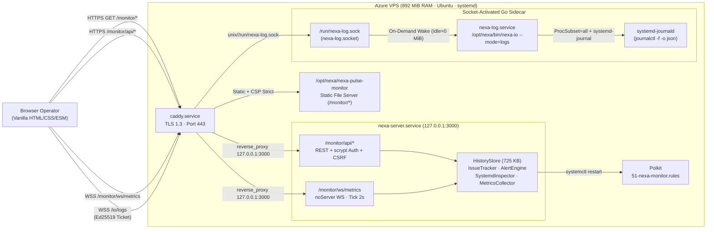

# 01 — Arsitektur Sistem & Infrastruktur VPS

Dokumen ini menjelaskan arsitektur teknis **N.E.X.A Pulse Monitor** secara menyeluruh: bagaimana browser operator, reverse proxy Caddy, proses utama Node.js (`nexa-server`), sidecar Go (`nexa-io`), dan systemd saling terhubung pada VPS berkapasitas terbatas (`892 MiB` RAM).

---

## 1. Gambaran Umum & Topologi Koneksi

N.E.X.A Pulse Monitor dipisahkan secara sengaja menjadi **konsol statis murni di sisi frontend** yang disajikan oleh Caddy, sementara data telemetri, otentikasi, kontrol restart, dan streaming log dialirkan melalui tiga jalur berbeda agar konsol tetap responsif bahkan saat proses utama `nexa-server` sedang restart.

---

## 2. Pemisahan Dua Repositori

Sistem ini terbagi atas dua repositori terpisah dengan batas tanggung jawab yang tegas:

| Repositori | Lokasi Lokal / VPS | Tanggung Jawab | Dependensi Build |
| :--- | :--- | :--- | :--- |
| **`nexa-pulse-monitor`** | Lokal: `C:\workspace\nexa-pulse-monitor` VPS: `/opt/nexa/nexa-pulse-monitor` | UI/UX konsol web, Vanilla HTML/CSS/ES Modules, parser protokol biner `/io/logs`, chart engine Canvas 2D HiDPI, Command Palette (`Ctrl+K`), preferensi browser (`localStorage`). | **Zero** (`npm` tidak dibutuhkan di VPS; Node.js hanya dipakai opsional untuk `dev-preview.js` & `verify_protocol.mjs`). |
| **`nexa-server`** | Lokal: `c:\workspace\nexa-server` VPS: `/home/nexa/nexa-server` | Modul `src/monitor/*` (kolektor metrik, binary ring store, issue tracker, alert engine, Polkit inspector, auth `scrypt`, WebSocket metrik), penerbit tiket Ed25519, serta sumber sidecar Go `nexa-io/`. | Node.js v22.x (`ws`, `express`) + Go compiler (hanya saat rebuild binary `nexa-io`). |

---

## 3. Komponen Backend Telemetri (`src/monitor/*`)

Seluruh subsistem observabilitas Node.js dikemas di balik facade [index.js](file:///c:/workspace/nexa-server/src/monitor/index.js) melalui fungsi `createMonitor()` / `getMonitor()`.

| Modul | Peran Teknis | Strategi Efisiensi Memori & CPU |
| :--- | :--- | :--- |
| `metrics_collector.js` | Mengambil CPU % proses & host (`/proc/stat`), RAM VPS (`/proc/meminfo`), Disk (`fs.statfsSync('/')`), Swap, V8 Heap, Event Loop Delay (`perf_hooks`), HTTP latency/throughput ring, AI call latency, status Bridges, AI Circuit Breakers, dan daftar Cron Job. | Zero-polling untuk mode 2s ketika tidak ada client. HTTP timing menggunakan circular buffer tetap `1,000` sampel (`HTTP_RING_CAPACITY = 1000`); AI ring `256` sampel (`AI_RING_CAPACITY = 256`). Offset resolusi `20 ms` pada `monitorEventLoopDelay({ resolution: 20 })` dikurangkan agar delay idle terbaca akurat (`~0.15 ms`). |
| `history_store.js` | Menyimpan histori 7 hari ke disk dalam format biner tetap (`monitor_metrics_7d.bin`) dan menyusun matriks **168 jam** (7×24) Application Health Heatmap. | Ukuran file **tidak pernah bertambah**: `24-byte` header + `10,080` record × `72 byte` = tepat **`725,784` bytes (~709 KiB)**. In-memory hot ring hanya menyimpan `60` sampel terakhir (`1 jam`). Flush ke disk dibatch tiap `5 menit` (`FLUSH_EVERY_TICKS = 5`) atau saat shutdown/restart. |
| `issue_tracker.js` | Menangkap error HTTP 5xx dan exception subsistem, menghitung fingerprint SHA-256 yang dinormalisasi (`fp_<8 hex>`), dan menyimpan daftar issue terdeduplikasi (`monitor_issues.json`). | Dibatasi keras maksimal **`200` issue unik** (`MAX_ISSUES = 200`), maksimal **`500` timestamp kejadian/issue**, dan `10` recent occurrences. Redaksi token/secret `FR-SEC-04` dijalankan sebelum masuk memori maupun disk. Penulisan atomik (`tmp` + `rename`) dengan debounce `1500 ms` + `flushSync()` saat crash fatal. |
| `alert_engine.js` | Mengevaluasi 5 aturan alert proaktif setiap tick `1 menit` (plus trigger langsung `fatal_exception`) dan mengirim notifikasi prioritas via Mobile Bridge (`Notifier.js`) atau Telegram fallback. | Mengamati **sustained breach streaks** (`1–15 menit`) untuk mencegah false positive dari lonjakan sesaat `1 detik`, dan menerapkan cooldown per rule (default `15 menit`, dapat diubah `1..120 menit`). Konfigurasi disimpan di `monitor_alerts.json`. |
| `systemd_inspector.js` | Memeriksa status 4 service VPS yang di-allowlist (`nexa-server.service`, `nexa-log.service`, `nexa-term.service`, `caddy.service`) serta mengecek file kill-switch terminal. | Menggunakan `execFile` langsung (`systemctl show`) tanpa shell dan tanpa `sudo`, timeout keras `2000 ms`, dan cache in-memory `3000 ms`. |
| `auth_service.js` | Autentikasi operator tunggal berbasis `scrypt`, manajemen session cookie, rate-limit brute-force per IP, validasi CSRF, dan ring audit keamanan. | Maksimal `4` sesi aktif serentak (`12 jam` TTL, hard ceiling `24 jam`), maksimal `512` bucket IP brute-force, maksimal `50` entri Security Audit Log. |
| `ws_metrics.js` | Server WebSocket `/monitor/ws/metrics` untuk streaming snapshot real-time setiap `2 detik`. | Berjalan dengan `{ noServer: true, maxPayload: 4096 }` agar hidup rukun bersama `/ws` Bridge Gateway di satu `http.Server`. **Zero Idle Overhead**: timer push 2s & heartbeat 30s otomatis berhenti total saat `wss.clients.size === 0`. |

---

## 4. Orkestrasi Proses (`systemd` & Cutover PM2 — Fase 5E)

Pada **Fase 5E**, proses `nexa-server` bermigrasi penuh dari PM2 ke `systemd` native (`nexa-server.service`), menghemat **~69 MiB RAM terpakai** pada VPS `892 MiB` (menghilangkan PM2 God Daemon dan agent eksternal).

### Unit Layanan di VPS

1. **`nexa-server.service`** (`/etc/systemd/system/nexa-server.service`)
   - Berjalan sebagai user `nexa` (`WorkingDirectory=/home/nexa/nexa-server`).
   - Flag V8 & Cgroup memory limit konsisten: `NODE_OPTIONS=--max-old-space-size=320`, `MemoryHigh=320M`, `MemoryMax=420M`.
   - `StandardOutput=journal` dan `StandardError=journal` dengan `SyslogIdentifier=nexa-server`.
   - Restart otomatis (`Restart=always`, `RestartSec=3`, `KillSignal=SIGTERM`, `TimeoutStopSec=15`).
   - `.env` dimuat langsung oleh Node.js (`dotenv` di `src/config/env.js`) agar hash `scrypt` bertanda `$` tidak mengalami ekspansi variabel oleh parser `systemd EnvironmentFile`.

2. **`nexa-log.socket` + `nexa-log.service`** (`/etc/systemd/system/nexa-log.service`)
   - Arsitektur **Socket Activation**: Unix socket `/run/nexa-log.sock` selalu mendengarkan tanpa menjalankan proses Go. Ketika Caddy meneruskan WebSocket pertama ke `/io/logs`, `systemd` langsung membangunkan `/opt/nexa/bin/nexa-io --mode=logs` (`~8–10 MiB` RAM).
   - Setelah seluruh browser & Mobile Bridge menutup tab Logs selama **`90 detik`** (`DefaultIdleTimeout = 90s`), `nexa-io` mematikan diri secara bersih kembali ke **`0 MiB` RAM**.
   - Menggunakan `SupplementaryGroups=systemd-journal` dan `ProcSubset=all` agar subproses `journalctl --no-pager -f -o json` dapat membaca `/var/log/journal` serta `/proc/sys/kernel/random/boot_id`.

3. **`nexa-term.socket` + `nexa-term.service`**
   - Sidecar terminal darurat untuk Mobile Bridge (`/io/term`), terlindungi oleh Hardware Kill Switch (`/opt/nexa/etc/terminal.enabled`) yang berstatus **Read-Only** di Web Monitor (`Controls` menampilkannya sebagai indikator status `ON/OFF` dan hanya bisa diubah lewat SSH VPS).

4. **`caddy.service`** (`/etc/caddy/Caddyfile`)
   - Terminator TLS 1.3 resmi untuk `nexa-server.indonesiacentral.cloudapp.azure.com`.
   - Mengarahkan `/monitor` → `/monitor/` (`308`), melayani file statis `/monitor/*`, mem-proxy `/monitor/api/*`, `/monitor/ws/metrics`, `/ws` ke `127.0.0.1:3000`, serta `/io/logs` ke `unix//run/nexa-log.sock`.

---

## 5. Direktori Persistensi Data Monitor

Di produksi Linux, backend menyimpan state persisten di **`/var/lib/nexa`** (dapat di-override via `NEXA_MONITOR_DATA_DIR`, fallback Windows/dev ke `data/monitor`):

| File | Format | Batas Ukuran | Isi |
| :--- | :--- | :--- | :--- |
| `monitor_metrics_7d.bin` | Binary ring fixed-size (`NXPM` v1) | **`725,784` bytes (~709 KiB)** | Hingga `10,080` sampel per menit (7 hari penuh) + flag koneksi bridge & restart. |
| `monitor_issues.json` | Atomik JSON (`tmp` → `rename`) | Dibatasi `200` issue unik | Grup exception & HTTP 5xx terdeduplikasi beserta stack trace yang sudah disensor (`FR-SEC-04`). |
| `monitor_alerts.json` | JSON | `< 4 KiB` | Status aktif/nonaktif rule alert, threshold kustom, sustained minutes, dan cooldown global. |

---

## 6. Format Record Biner 7-Hari (`NXPM` v1)

Setiap menit sekali, `MetricsCollector` menulis 1 record tepat **`72 byte`** little-endian ke `HistoryStore`:

| Offset | Tipe | Field | Satuan / Keterangan |
| :--- | :--- | :--- | :--- |
| `0..7` | `DoubleLE` | `tsSec` | Unix timestamp (detik) |
| `8..11` | `FloatLE` | `cpuPct` | CPU proses `nexa-server` (%) |
| `12..15` | `FloatLE` | `vpsCpuPct` | Total CPU host VPS (%) |
| `16..19` | `FloatLE` | `vpsAvailMb` | `MemAvailable` VPS (MiB) |
| `20..23` | `FloatLE` | `rssMb` | Node RSS memory (MiB) |
| `24..27` | `FloatLE` | `heapUsedMb` | V8 Heap Used (MiB) |
| `28..31` | `FloatLE` | `heapTotalMb` | V8 Heap Total (MiB) |
| `32..35` | `FloatLE` | `elMeanMs` | Event loop delay rata-rata (ms) |
| `36..39` | `FloatLE` | `elP95Ms` | Event loop delay P95 (ms) |
| `40..43` | `FloatLE` | `httpReqMin` | Throughput HTTP (req/menit) |
| `44..47` | `FloatLE` | `httpMeanMs` | Latensi HTTP rata-rata (ms) |
| `48..51` | `FloatLE` | `httpP95Ms` | Latensi HTTP P95 (ms) |
| `52..55` | `UInt32LE` | `activeHandles` | Jumlah libuv active handles |
| `56..59` | `UInt32LE` | `activeReqs` | Jumlah in-flight requests |
| `60..61` | `UInt16LE` | `issuesDelta` | Jumlah issue baru sejak sampel menit sebelumnya |
| `62..63` | `UInt16LE` | `flags` | Bitmask: `0x01` Mobile online, `0x02` Windows online, `0x04` Live Call aktif, `0x08` Restart terjadi |
| `64..67` | `FloatLE` | `aiReqMin` | Throughput panggilan AI/LLM (req/menit) |
| `68..71` | `FloatLE` | `aiMeanMs` | Latensi rata-rata panggilan AI/LLM (ms) |

### Aturan Status Application Health Heatmap (168 Sel / 7 Hari)
Untuk setiap slot 1 jam pada halaman Overview:
- **`nodata`**: `samples === 0`
- **`incident`** (merah/rose): `restarted === true` atau `issues >= 5` dalam 1 jam tersebut
- **`degraded`** (amber): `issues >= 1` atau `elP95Max > 50 ms` atau (`heapPctMax > 92% && heapUsedMax > 220 MiB`) atau `avgRssMb > 300 MiB`
- **`healthy`** (emerald): Semua metrik berada di zona aman
