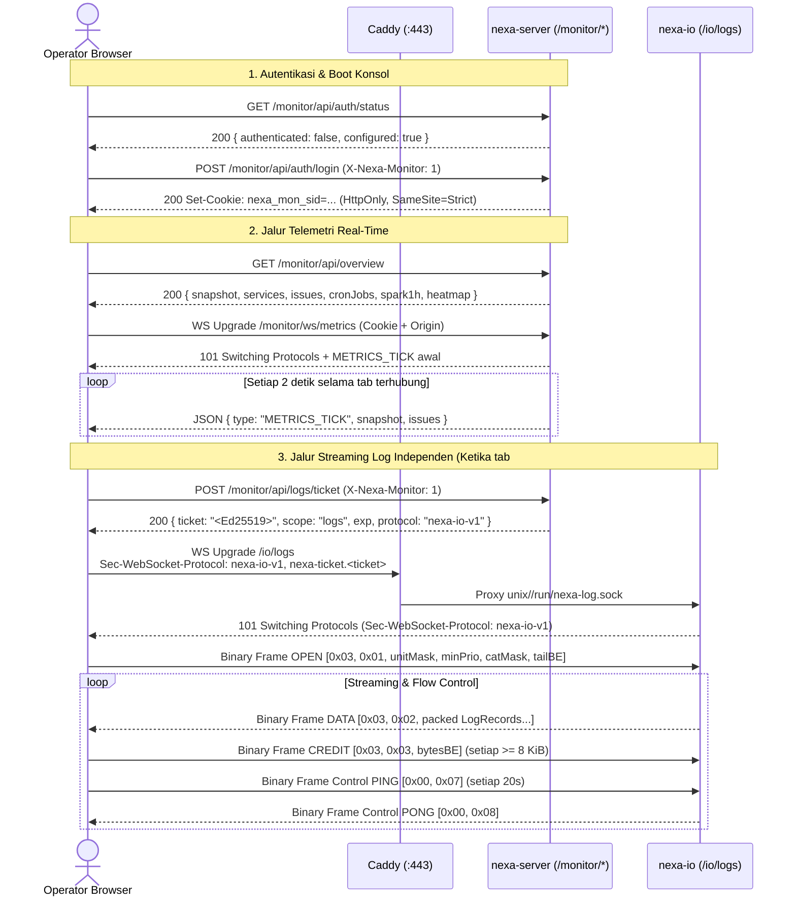

# 02 — Arsitektur Koneksi, API & Protokol Wire

N.E.X.A Pulse Monitor berkomunikasi dengan backend melalui **3 jalur koneksi yang saling melengkapi**. Pemisahan ini memastikan dashboard tetap hemat bandwidth, responsif setiap 2 detik saat aktif, tidak menambah beban ketika tab ditutup, serta tetap dapat melihat log saat Node.js sedang restart.

---

## 1. Alur Koneksi End-to-End (Sequence)



---

## 2. Jalur 1 — REST API (`/monitor/api/*`)

Semua endpoint diimplementasikan di `src/monitor/router.js` dengan header respons standar:
- `Cache-Control: no-store, no-cache, must-revalidate, private`
- `Pragma: no-cache`
- `X-Robots-Tag: noindex, nofollow`
- Seluruh endpoint selain `/auth/status` dan `/auth/login` dilindungi middleware `auth.requireAuth()`.
- Seluruh request mutasi (`POST`) wajib menyertakan header CSRF **`X-Nexa-Monitor: 1`** serta `Origin` yang ada dalam allowlist server.

### Daftar Endpoint

#### A. Autentikasi & Sesi
| Method | Path | CSRF | Auth | Fungsi & Respons |
| :--- | :--- | :---: | :---: | :--- |
| `GET` | `/monitor/api/auth/status` | Tidak | Publik | Mengembalikan `{ authenticated, configured, session? }`. Tanpa fingerprinting versi/infra saat belum login. |
| `POST` | `/monitor/api/auth/login` | Wajib | Publik | Validasi `username` & `password` dengan `scrypt`. Mengembalikan `Set-Cookie: nexa_mon_sid=...` dan `session`. Mengembalikan `429` + `Retry-After` saat IP terkunci brute-force. |
| `POST` | `/monitor/api/auth/logout` | Wajib | Opsional | Menghapus sesi aktif saat ini dan membersihkan cookie. |
| `POST` | `/monitor/api/auth/sessions/revoke-all` | Wajib | Wajib | Mencabut **seluruh** sesi operator yang aktif (`revoked` count) dan menutup socket `/monitor/ws/metrics` yang terhubung. |

#### B. Telemetri & Histori
| Method | Path | CSRF | Fungsi & Respons |
| :--- | :--- | :---: | :--- |
| `GET` | `/monitor/api/overview` | Tidak | Snapshot komplit untuk halaman Overview: `{ snapshot, services, issues, cronJobs, spark1h, heatmap }`. |
| `GET` | `/monitor/api/metrics/history` | Tidak | Query param `range` (`1h`, `6h`, `24h`, `7d`) dan `maxPoints` (`10..360`, default `180`). Mengembalikan deret waktu downsampled dari `monitor_metrics_7d.bin` + `current` snapshot. |

#### C. Issue & Error Tracking
| Method | Path | CSRF | Fungsi & Respons |
| :--- | :--- | :---: | :--- |
| `GET` | `/monitor/api/issues` | Tidak | Query param `status` (`unresolved`, `resolved`, `all`), `subsystem`, `search`. Mengembalikan `{ summary, issues }`. |
| `GET` | `/monitor/api/issues/:fingerprint` | Tidak | Detail lengkap satu issue termasuk stack trace ter-redaksi `FR-SEC-04`, metadata git commit, dan `recentOccurrences`. |
| `POST` | `/monitor/api/issues/:fingerprint/resolve` | Wajib | Menandai issue sebagai `resolved` dan mencatat audit log `ISSUE_RESOLVED`. |
| `POST` | `/monitor/api/issues/:fingerprint/reopen` | Wajib | Membuka kembali issue yang berstatus `resolved`. |
| `POST` | `/monitor/api/issues/clear-resolved` | Wajib | Menghapus seluruh issue yang berstatus `resolved` dan mencatat audit log `ISSUES_CLEARED`. |

#### D. Tiket Streaming Log
| Method | Path | CSRF | Fungsi & Respons |
| :--- | :--- | :---: | :--- |
| `POST` | `/monitor/api/logs/ticket` | Wajib | Menerbitkan tiket **single-use Ed25519** (`scope=logs`, TTL `45 detik`) untuk WebSocket `/io/logs`. Mengembalikan `{ ticket, scope: "logs", exp, protocol: "nexa-io-v1" }` (atau `429` bila rate limit tiket tercapai). |

#### E. Controls, Proactive Alerts & Aksi Server
| Method | Path | CSRF | Fungsi & Respons |
| :--- | :--- | :---: | :--- |
| `GET` | `/monitor/api/controls` | Tidak | Mengambil status 4 unit systemd, active live voice calls, AI circuit breakers, rules & cooldown alert, channel routing (`Mobile Bridge` vs `Telegram Fallback`), sesi aktif, dan Security Audit Log. |
| `POST` | `/monitor/api/controls/alerts-settings` | Wajib | Mengubah cooldown global notifikasi alert (`cooldownMinutes`: `1..120`). |
| `POST` | `/monitor/api/controls/alerts/test` | Wajib | Mengirim test alert ke Mobile Bridge / Telegram fallback (rate limit `10 detik` per permintaan). |
| `POST` | `/monitor/api/controls/alerts/:ruleId` | Wajib | Mengubah status `enabled`, threshold (`thresholdMb`, `thresholdMs`, `thresholdCount`), dan `sustainedMinutes` pada salah satu rule alert. |
| `POST` | `/monitor/api/actions/reset-breakers` | Wajib | Memanggil `Provider_Health.resetBreakers()` untuk mereset circuit breaker AI & cooldown API key. |
| `POST` | `/monitor/api/actions/reset-metrics` | Wajib | Mereset histogram latensi HTTP & Event Loop serta peak counter di memori (`RESET MONIT`). |
| `POST` | `/monitor/api/actions/restart` | Wajib | Menjadwalkan `systemctl --no-block restart nexa-server.service` via Polkit. Mengembalikan `409 LIVE_CALL_ACTIVE` jika ada voice call aktif kecuali dikirim `{ force: true }`. Jika aman, mengembalikan `202 RESTART_SCHEDULED`. |

---

## 3. Jalur 2 — Live Metrics WebSocket (`/monitor/ws/metrics`)

Dikelola oleh `MonitorMetricsWebSocket` (`src/monitor/ws_metrics.js`) dan `MetricsSocketClient` (`js/api.js`):

- **Handshake:** Memvalidasi `Origin` (`403` jika ditolak) dan cookie sesi `nexa_mon_sid` (`401` jika tidak sah) sebelum HTTP upgrade. Batas klien serentak: **`MAX_MONITOR_WS_CLIENTS = 4`** (`429` jika penuh).
- **Format Pesan Server → Client (JSON):**
  ```json
  {
    "type": "METRICS_TICK",
    "snapshot": { "...": "..." },
    "issues": { "last1h": 0, "last24h": 0, "last7d": 0, "unresolved": 0, "resolved": 0 }
  }
  ```
- **Kontrol Client → Server (JSON):**
  - `{ "type": "PAUSE" }` → menghentikan pengiriman tick ke socket ini (dipakai saat tombol Pause aktif di Metrics view).
  - `{ "type": "RESUME" }` → langsung mengirim 1 snapshot terbaru lalu melanjutkan tick 2s.
- **Cadence & Zero Idle Overhead:**
  - Server mengirim setiap **`2,000 ms`**. Mode **Eco (`5s`)** di preferensi konsol mem-throttle pembaruan DOM client-side tiap `>= 4,500 ms` agar CPU browser tetap hemat.
  - Saat `wss.clients.size === 0`, timer broadcast dan heartbeat `30s` langsung dihentikan.
  - Sesi yang dicabut atau kadaluwarsa ditutup dengan kode WebSocket **`4001`** (`Session expired`).
  - Browser melakukan auto-reconnect dengan capped exponential backoff (`1.5s * 2^attempt`, maksimal `15 detik`).

---

## 4. Jalur 3 — Binary Log Stream (`WSS /io/logs` via `nexa-io`)

Jalur ini melayani **Web Monitor** (`#logs`) dan **Android Mobile Bridge** secara bersamaan melalui satu sidecar Go (`/opt/nexa/bin/nexa-io --mode=logs`).

### A. Negosiasi Subprotocol Browser (RFC 6455)
Karena Browser WebSocket API tidak mengizinkan header kustom `Authorization`, autentikasi tiket Ed25519 dikirim aman lewat `Sec-WebSocket-Protocol` (tidak pernah lewat URL query string agar tidak bocor di log proxy):

```javascript
new WebSocket(
  'wss://nexa-server.indonesiacentral.cloudapp.azure.com/io/logs',
  ['nexa-io-v1', `nexa-ticket.${ticket}`]
);
```
Server `nexa-io` memverifikasi signature Ed25519 + expiry + single-use JTI, lalu merespons `Sec-WebSocket-Protocol: nexa-io-v1`.

### B. Struktur Frame Biner (Big-Endian)

Seluruh frame memiliki header minimal 2 byte dan payload maksimal **`4,096` byte (`4 KiB`)** per frame (`permessage-deflate` dinonaktifkan):

```text
+------------+------------+----------------------------------+
| ch (u8)    | op (u8)    | payload (0 .. 4096 bytes)        |
+------------+------------+----------------------------------+
```

#### Channel IDs (`ch`)
- `0x00` — `CH_CONTROL` (Ping / Pong)
- `0x03` — `CH_LOGS` (Log streaming)

#### Opcode (`op`)
| Opcode | Nilai | Arah | Fungsi |
| :--- | :---: | :---: | :--- |
| `OP_OPEN` | `0x01` | C → S | Membuka/memperbarui stream log dengan parameter filter. |
| `OP_DATA` | `0x02` | S → C | Payload berisi 1 atau lebih `LogRecord` biner yang dipaketkan rapat. |
| `OP_CREDIT` | `0x03` | C → S | Menambah jatah kuota byte agar server mengirim batch berikutnya (backpressure). |
| `OP_CLOSE` | `0x04` | C ↔ S | Penutupan bersih stream. |
| `OP_ERR` | `0x06` | S → C | Error frame `[0x03, 0x06, errCode: u8, utf8Msg]`. |
| `OP_PING` | `0x07` | C ↔ S | Keepalive frame `[0x00, 0x07]` untuk menjaga koneksi tetap hidup. |
| `OP_PONG` | `0x08` | C ↔ S | Balasan keepalive `[0x00, 0x08]`. |

### C. Spesifikasi Payload Utama

#### 1. `OPEN` Frame (`7 byte` total: 2 header + 5 payload)
```text
[0x03] [0x01] [unit_mask: u8] [min_prio: u8] [cat_mask: u8] [tail_lines: u16 BE]
```
- **`unit_mask` (bitmask):**
  - `0x01` = `nexa-server` (`0`)
  - `0x02` = `caddy` (`1`)
  - `0x04` = `systemd` (`2` — kernel & lifecycle PID 1 unit whitelist)
  - `0x08` = `nexa-io` (`3` — `nexa-log.service` & `nexa-term.service`)
  - `0x0F` = `All Units`
- **`min_prio` (RFC 5424):** `7` (ALL / Debug), `4` (WARN/ERROR), `3` (Errors only). Di Web Monitor: preset `Errors` memakai `minPrio = 4`, preset lainnya `7`.
- **`cat_mask` (bitmask dari tag `[cat=...]` di `logger.js`):**
  - `0x00` = All Categories
  - `0x01` = `FINANCE`
  - `0x02` = `BRIDGE`
  - `0x04` = `AUTH`
  - `0x08` = `CORE`
- **`tail_lines`:** `10..500` (Web UI menyediakan pilihan `Tail 100`, `200`, `500`).

#### 2. `DATA` Frame — Packed `LogRecord` (`13-byte header + message`)
Setiap record dalam payload `OP_DATA` disusun berurutan:
```text
Offset 0   (1 byte)  : prio (u8 — RFC 5424 severity 0..7)
Offset 1   (1 byte)  : unit_id (0=nexa-server, 1=caddy, 2=systemd, 3=nexa-io)
Offset 2   (1 byte)  : cat_flags (u8 bitmask)
Offset 3   (8 bytes) : timestamp_ms (u64 BE — epoch milliseconds)
Offset 11  (2 bytes) : msg_len (u16 BE — maksimal 2,048 bytes, >2048 dipotong + [TRUNCATED])
Offset 13..          : UTF-8 log message (sudah dibersihkan ANSI & tag [cat=...])
```
`nexa-io` mengelompokkan output maksimal **`30` baris per `150 ms`** (`200 lines/sec`) agar UI browser tidak mengalami lag render saat terjadi badai log.

#### 3. Backpressure `CREDIT` & Keepalive `20s` (Mekanisme Anti-Drop)
- **True Backpressure:** Server memulai koneksi dengan kredit kirim awal **`32 KiB`** (`InitialLogCredit`). Browser (`LogsStreamClient` di `js/logs_client.js`) menghitung byte `OP_DATA` yang diterima dan mengirim `CREDIT` `[0x03, 0x03, bytes: u32 BE]` setiap akumulasi `>= 8,192 bytes` (`8 KiB`). Saat operator menekan **Pause**, client **menahan pengiriman CREDIT** selama hingga 5 menit (`DefaultPauseTimeout`), sehingga server berhenti mengirim dan memori VPS tidak membengkak.
- **20-Second Keepalive:** `nexa-io` menerapkan batas baca **`45 detik`** (`DefaultReadDeadline = 45s`). Untuk mencegah pemutusan koneksi saat server sedang sunyi (tidak ada log baru & tidak ada tombol ditekan), `LogsStreamClient` mengirim Control `PING` `[0x00, 0x07]` setiap **`20 detik`**.
- **Pergantian Filter In-Place:** Mengubah filter kategori/unit/tail pada UI **tidak** memutus WebSocket ataupun meminta tiket baru (`429` safe) — client cukup mengirim frame `OPEN` baru di atas socket yang sudah terbuka.
